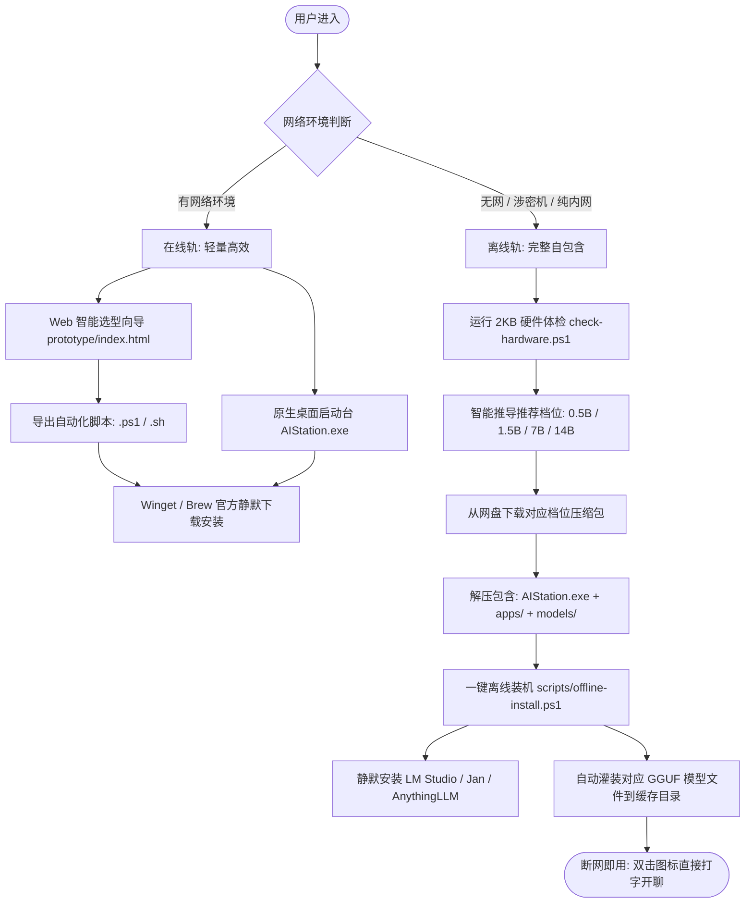

# AI Station Pro (AI_OneClick) · 开发者与工作交接白皮书

> **适用对象**：接手本项目的前端、客户端、自动化运维或全栈开发人员。  
> **文档版本**：v1.0.0 (2026-10-15)  
> **开源仓库**：[https://github.com/LionZLH/AI_OneClick](https://github.com/LionZLH/AI_OneClick)

---

## 目录

1. [项目概览与核心设计哲学](#一-项目概览与核心设计哲学)
2. [双轨制交付架构](#二-双轨制交付架构)
3. [工程代码库拓扑与文件职责](#三-工程代码库拓扑与文件职责)
4. [核心模块与源码深度解析](#四-核心模块与源码深度解析)
   - [4.1 原生桌面启动台 (src/AIStation.cs)](#41-原生桌面启动台-srcaistationcs)
   - [4.2 硬件体检与推荐引擎 (scripts/check-hardware.*)](#42-硬件体检与推荐引擎-scriptscheck-hardware)
   - [4.3 纯离线安装与模型注入 (scripts/offline-install.*)](#43-纯离线安装与模型注入-scriptsoffline-install)
   - [4.4 Web 选型向导与脚本生成器 (prototype/)](#44-web-选型向导与脚本生成器-prototype)
5. [编译、构建与打包指南](#五-编译构建与打包指南)
6. [测试与质量验证体系](#六-测试与质量验证体系)
7. [业务扩展：如何新增一款 AI 客户端](#七-业务扩展如何新增一款-ai-客户端)
8. [关键踩坑点与排障避错备忘录](#八-关键踩坑点与排障避错备忘录)
9. [交接清单与后续迭代路线](#九-交接清单与后续迭代路线)

---

## 一、 项目概览与核心设计哲学

### 1.1 项目背景
面对市面上大量 AI 大模型与客户端，普通用户常遇到以下痛点：
- **认知壁垒与流氓捆绑**：找不到官方安全入口，搜索易下载到附带广告流氓软件的安装包。
- **配置与显存焦虑**：不懂参数与显存要求，误装导致系统卡死或运行报错。
- **离线涉密场景空白**：政企或内网用户无法联网，却缺少一键安装包与模型灌装方案。

### 1.2 三大核心设计铁律（交接必须坚持的原则）
接手本项目时，请务必遵守以下三条硬性约束：
1. **坚决拒绝虚标与伪造（Zero-Gimmick）**：
   - 严禁加入“假进度条”、“假跳动数字”、“假 MD5 校验点”。
   - 所有硬件参数必须走 Windows API / WMI 真实探测；所有安装必须调用系统真实的包管理器（`winget`）或官方静默包。
2. **严守法律合规红线（Zero-Proxy / Clean Legal Boundary）**：
   - **严禁**集成任何 VPN、梯子、SSR、Clash 等网络穿透工具；
   - 国内客户端优先（免翻扫码即用）；海外工具遵循技术中立原则，仅提供官方下载，不提供网络代理通道；
   - 开源模型保留原作者开源协议，项目定位为“自动化配置服务”，严禁擅自宣称模型自研。
3. **极简轻量、零运行时依赖（Zero-Bloat Runtime）**：
   - 客户端启动台采用 C# Windows Forms 单文件架构，直接使用 Windows 系统底层自带的 `.NET Framework 4.8` 编译器编译（体积仅 **29 KB**）；
   - **严禁**使用 Electron 或打包庞大 Chromium 运行时，确保老旧电脑与轻薄本秒开。

---

## 二、 双轨制交付架构

项目提供“在线轻量版”与“离线完整版”双轨交付机制：



---

## 三、 工程代码库拓扑与文件职责

```text
AI客户端一键装机助手/
├── src/                               # 原生桌面客户端源码
│   └── AIStation.cs                   # 单文件 C# WinForms 桌面启动台（核心）
├── scripts/                           # 跨平台自动化安装与检测脚本
│   ├── check-hardware.ps1             # Windows 硬件体检工具（支持 PS 5.1+，UTF-8 BOM）
│   ├── check-hardware.sh              # macOS 硬件体检脚本（Zsh/Bash 兼容）
│   ├── offline-install.ps1            # Windows 纯离线安装与 GGUF 模型灌装脚本
│   └── offline-install.sh             # macOS 纯离线安装脚本
├── prototype/                         # Web 端选型向导与静态站点
│   ├── index.html                     # 选型问卷与全量自选前端入口
│   ├── catalog.js                     # 19 款 AI 客户端元数据库与推荐矩阵规则
│   ├── app.js                         # 前端业务逻辑、事件绑定与脚本生成导出
│   ├── console.html                   # 高级调试控制台
│   ├── console.js                     # 控制台解析与执行引擎
│   └── style.css                      # 深色主题全局样式表
├── tests/                             # 自动化测试套件
│   ├── catalog.test.cjs               # Node.js 单元测试（校验目录去重、URL合法性、脚本生成）
│   └── test-remote.ps1                # Windows 真实靶机端到端远程测试套件
├── docs/                              # 项目设计与验证归档文档
│   ├── DEVELOPMENT.md                 # 【当前文件】开发者与工作交接白皮书
│   ├── catalog-sources.md             # 选品清单官方信源与安装包验证记录
│   ├── verification.md                # 本机真实执行与测试记录证据
│   └── screenshots/                   # 界面截图归档
├── installers/                        # 离线打包配置文件与辅助模板
├── models/                            # 离线部署时放置 GGUF 模型的目录（默认不提 Git）
├── apps/                              # 离线部署时放置离线安装包的目录（默认不提 Git）
├── AIStation.exe                      # 已编译好的 Windows 原生可执行文件 (29 KB)
├── README.md                          # 面向终端用户的说明与项目立项书
└── package.json                       # 测试套件配置（支持 npm test）
```

---

## 四、 核心模块与源码深度解析

### 4.1 原生桌面启动台 (`src/AIStation.cs`)

* **技术栈**：C# 7.3+, Windows Forms, P/Invoke Win32 API
* **体积**：编译后仅 29 KB，零依赖，直接调用操作系统自带的 `.NET Framework 4.8` 运行时。
* **主要职责**：
  1. **DPI 高分屏适配**：在 `Main()` 启动时通过 `SetProcessDPIAware()` 声明感知，杜绝 4K/2K 屏幕模糊。
  2. **暗黑现代 UI 渲染**：自定义 `FlowLayoutPanel`，卡片带圆角投影与平滑悬停高亮（`ColBg: #181A20`, `ColCard: #22252E`）。
  3. **双重检测引擎 (`RefreshInstalledStatus`)**：
     - **已知标准路径扫描**：检查 `%LocalAppData%\Programs\...` 及 `%ProgramFiles%\...`；
     - **注册表穿透扫描 (`CheckRegistryUninstall`)**：深度遍历 `HKCU` 和 `HKLM`（包含 64位与 WOW6432Node）下的 `Uninstall` 节点，对比 `DisplayName` 与 `DisplayIcon`，即使用户装在非 C 盘也能准确定位真实 `.exe` 路径。
  4. **异步静默安装与 UI 响应**：
     - 使用 `ThreadPool.QueueUserWorkItem` 脱离主线程执行 `winget install <id> --silent` 或运行本地 `apps/*.exe`；
     - 通过 `Invoke((MethodInvoker)(...))` 在安装完成后无缝刷新卡片状态，从「一键安装」平滑切换为「🚀 启动」。
  5. **底层硬件探测**：
     - 通过 `kernel32.dll` 的 `GlobalMemoryStatusEx` API 获取准确的物理内存总字节数；
     - 读取注册表 `HARDWARE\DESCRIPTION\System\CentralProcessor\0\ProcessorNameString` 获取真实 CPU 名称。

---

### 4.2 硬件体检与推荐引擎 (`scripts/check-hardware.*`)

* **运行规范**：纯只读脚本，严禁任何提权申请或写入操作。
* **探测指标**：
  - 操作系统位宽（必须 64 位）
  - CPU AVX2 指令集（使用内联 C# 代码探测 `System.Runtime.Intrinsics.X86.Avx2.IsSupported`，无 AVX2 现代模型推理将极其卡顿）
  - 物理内存容量（精确计算 GB）
  - 系统盘剩余空间（判断是否够放模型与安装包）
  - 独立/核芯显卡名称与显存（VRAM）
* **分档推荐模型标准**：
  | 物理内存容量 | 推荐模型规格 | 模型文件 | 对应离线包档位 |
  | :--- | :--- | :--- | :--- |
  | **< 8 GB** (4~8GB) | Qwen2.5-0.5B (0.4 GB) | `Qwen2.5-0.5B-Instruct-Q4_K_M.gguf` | AI装机-入门版 |
  | **8 ~ 16 GB** | Qwen2.5-1.5B (1.1 GB) | `Qwen2.5-1.5B-Instruct-Q4_K_M.gguf` | AI装机-基础版 |
  | **16 ~ 32 GB** | Qwen2.5-7B (4.7 GB) | `Qwen2.5-7B-Instruct-Q4_K_M.gguf` | AI装机-标准版 |
  | **>= 32 GB** | Qwen2.5-14B (9.0 GB) | `Qwen2.5-14B-Instruct-Q4_K_M.gguf` | AI装机-完整版 |

---

### 4.3 纯离线安装与模型注入 (`scripts/offline-install.*`)

针对断网环境，脚本执行全自动流水线：
1. **静默安装应用**：循环扫描当前目录 `./apps/` 下的所有安装程序，使用 `/S` 参数静默部署：
   - `lmstudio-setup.exe`
   - `anythingllm-setup.exe`
   - `jan-setup.exe`
   - `gpt4all-setup.exe`
2. **GGUF 模型精准注入（模型灌装）**：
   无需用户手动寻找深层缓存目录，脚本自动创建路径并以字节校验模式搬运模型：
   - **LM Studio 目标路径**：
     `$env:USERPROFILE\.cache\lm-studio\models\lmstudio-community\Qwen2.5-Instruct-GGUF\`
   - **Jan 目标路径**：
     `$env:APPDATA\jan\models\`
   - **GPT4All 目标路径**：
     `$env:LOCALAPPDATA\nomic.ai\GPT4All\`

---

### 4.4 Web 选型向导与脚本生成器 (`prototype/`)

* **无框架纯原生实现**：采用 HTML5 + ES6 + 原生 CSS，不依赖 npm 打包构建，双击 `index.html` 即可运行。
* **数据驱动**：`catalog.js` 统一管理 19 款工具（13 款桌面 + 6 款网页），每个条目均维护了 `winget`、`brew`、`isLocalLLM` 等元数据。
* **脚本动态装配**：`app.js` 内置 `generateScript(selectedIds, osType)` 函数，能够根据用户勾选的一组工具，现场拼装出带硬件检查、静默安装循环、模型下载与自动清理的完整 `.ps1` / `.sh` 脚本。

---

## 五、 编译、构建与打包指南

### 5.1 编译 Windows 原生启动台 (`AIStation.exe`)
本项目**不需要**安装重量级的 Visual Studio，任何一台装有 Windows 10/11 的电脑，均自带了 .NET Framework 4.8 编译器。

在 Windows 终端执行以下编译命令：
```cmd
C:\Windows\Microsoft.NET\Framework64\v4.0.30319\csc.exe /target:winexe /out:AIStation.exe /optimize+ /platform:anycpu src\AIStation.cs
```
* **参数解释**：
  - `/target:winexe`：生成无黑框控制台的原生 Windows 图形界面程序；
  - `/optimize+`：开启代码优化，压缩体积并提升运行速度；
  - `/platform:anycpu`：同时兼容 64位与 32位系统。
  - 产物仅一个独立文件 `AIStation.exe`（约 29KB），双击立即可用。

### 5.2 制作离线分发大包（网盘/U盘交付）
离线大包的标准组织目录规范如下：
```text
AI装机-标准版（16GB+内存）/
├── AIStation.exe                      # 原生启动台
├── 双击运行一键装机.lnk                # 指向 scripts/offline-install.ps1 的快捷方式
├── scripts/
│   ├── offline-install.ps1
│   └── check-hardware.ps1
├── apps/                              # 放入对应离线安装包
│   ├── LM-Studio-0.3.9-Setup.exe
│   ├── AnythingLLMDesktop.exe
│   └── Jan-Setup-0.5.14.exe
└── models/                            # 放入对应档位的 GGUF 模型
    └── Qwen2.5-7B-Instruct-Q4_K_M.gguf
```
打包为 `.zip` 或拷贝至 FAT32/exFAT 格式 U 盘即可对外分发。

---

## 六、 测试与质量验证体系

为了防止代码迭代破坏已有功能，项目配置了双层自动化测试机制：

### 6.1 本地静态与逻辑单元测试
在工程根目录下执行（需要 Node.js 18+）：
```bash
node --test tests/*.test.cjs
```
**测试覆盖范围**：
- `catalog.js` 中所有工具 ID 与名称的唯一性校验；
- 所有下载链接必须为 HTTPS 官方协议；
- 问卷推荐逻辑与场景匹配过滤矩阵；
- `generateScript()` 针对 Windows (`.ps1`) 与 macOS (`.sh`) 的代码语法合法性。

### 6.2 Windows 真实靶机端到端测试
在 Windows 目标机器上以管理员或普通用户运行：
```powershell
powershell -ExecutionPolicy Bypass -File tests\test-remote.ps1
```
**验证指标**：
1. 硬件体检工具能否正确探测当前 CPU、真实内存、AVX2 指令集；
2. 本机 AI 客户端真实检测率（对比注册表与文件系统）；
3. 本机 `winget` 连通性及微软官方源中各大 AI 客户端安装包的存在性；
4. 离线安装逻辑与目录结构可达性。

---

## 七、 业务扩展：如何新增一款 AI 客户端

当市面上出现新的优质 AI 客户端（如某新型本地客户端）需要收录时，请同步修改以下两处代码：

### 步骤 1：在 `prototype/catalog.js` 中注册元数据
在 `const apps = [...]` 数组中追加：
```javascript
// 示例：新增 MyClient
['myclient', 'MyClient', 'M', 'blue', 'domestic', 'desktop', '出品厂商', '应用特色功能一句话介绍。', ['场景标签1', '场景标签2'], 'https://myclient.example.com', '使用注意事项或额度说明。']
```
并在 `const installMeta = {...}` 中补充安装参数：
```javascript
myclient: {
  winget: 'Vendor.MyClient',   // 若已收录于 WinGet，填写 WinGet ID；若无则填 null
  brew: 'myclient',            // macOS Homebrew Cask 名称
  direct: 'https://myclient.example.com/download', // 官方下载落地页
  isLocalLLM: false            // 是否为需要灌装 GGUF 本地模型的工具
}
```

### 步骤 2：在 `src/AIStation.cs` 中增加检测与启动规则
在 `InitializeData()` 的 `_allApps` 列表中追加：
```csharp
new AppItem {
    Id = "myclient", 
    Name = "MyClient", 
    Vendor = "出品厂商", 
    Group = "domestic", 
    Type = "desktop",
    Desc = "应用特色功能一句话介绍。",
    Url = "https://myclient.example.com", 
    WingetId = "Vendor.MyClient",
    ExeNames = new[] { "MyClient.exe" },
    CommonPaths = new[] {
        Path.Combine(localApp, @"Programs\MyClient\MyClient.exe"),
        Path.Combine(progFiles, @"MyClient\MyClient.exe")
    }
}
```
保存后重新运行 `csc.exe` 重新编译 `AIStation.exe` 即可。

---

## 八、 关键踩坑点与排障避错备忘录

在维护和扩展本项目脚本时，请**务必注意**以下几个历史踩坑经验：

### 1. PowerShell 5.1 中文乱码与 UTF-8 BOM 陷阱（致命）
- **现象**：在 Windows 10/11 默认的 PowerShell 5.1 下执行包含中文字符的 `.ps1` 脚本时，中文字符变成乱码，甚至报语法解析错误。
- **原因**：PS 5.1 默认将无 BOM 的 UTF-8 文件当做系统当前代码页（GBK / CP936）解析。
- **解决铁律**：所有 `.ps1` 文件保存时**必须附带 UTF-8 BOM (`\uFEFF`) 头**，并在脚本头部显式声明：
  ```powershell
  [Console]::OutputEncoding = [System.Text.Encoding]::UTF8
  ```

### 2. PowerShell 5.1 语法解析器差异
- **陷阱**：在参数内写 `(if(...) { ... })` 会在 PowerShell 5.1 中触发 `UnexpectedToken` 语法中断。
- **正确写法**：必须使用子表达式语法 `$(if(...) { ... })`。
- **字符串重复陷阱**：`Write-Host "─" * 60` 会被误解析为三个参数，必须加括号：`Write-Host ("─" * 60)`。

### 3. Winget 源协议与静默参数
- 通过命令行调用 `winget` 时，必须附加协议同意参数，否则后台静默安装会因等待用户按 Y 确认而无限期挂起：
  ```powershell
  winget install "<WingetId>" --silent --accept-package-agreements --accept-source-agreements
  ```

### 4. 注册表 32 位与 64 位视图穿透
- 许多 Electron 封装的 AI 应用安装在 32 位节点或当前用户目录。检测时**必须同时查询**：
  - `HKCU:\Software\Microsoft\Windows\CurrentVersion\Uninstall`
  - `HKLM:\SOFTWARE\Microsoft\Windows\CurrentVersion\Uninstall`
  - `HKLM:\SOFTWARE\WOW6432Node\Microsoft\Windows\CurrentVersion\Uninstall`

---

## 九、 交接清单与后续迭代路线

### 9.1 工作交接自查清单
- [x] 代码库 Git 权限已移交，主分支代码与远端 GitHub 同步；
- [x] 本机自动化单元测试通过 (`node --test tests/*.test.cjs` 9/9 pass)；
- [x] 目标 Windows 靶机实测通过（硬件检测、已装客户端扫描、Winget 连通性）；
- [x] 原生 `AIStation.exe` 编译流程清晰，可在无任何 SDK 的裸机上一键产出；
- [x] 明确项目无代理工具、无非法流量穿透的合规底线。

### 9.2 建议后续迭代演进方向
1. **安装进度可视化**：在 `AIStation.exe` 中针对 `winget` 管道输出实现流式行读取，将下载百分比同步显示在卡片下方进度条中。
2. **模型多选与切换**：离线版目前默认灌装 Qwen2.5 系列，未来可扩充 DeepSeek-R1-Distill 系列（如 1.5B / 7B / 8B）的同台切换支持。
3. **macOS 原生状态栏小工具**：当前 macOS 主要依赖 `scripts/check-hardware.sh` 与 Web 脚本导出，未来可利用 Swift 开发对应轻量菜单栏状态器。

---
*文档编制完成于 2026-10-15。如有疑问，请查阅仓库 issue 或与核心维护者联系。*
